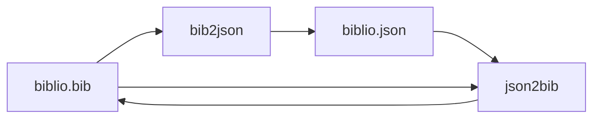
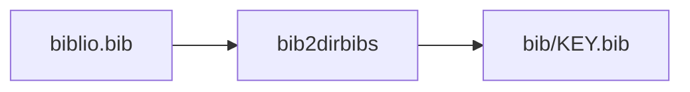
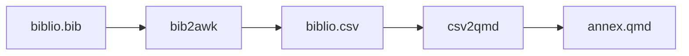
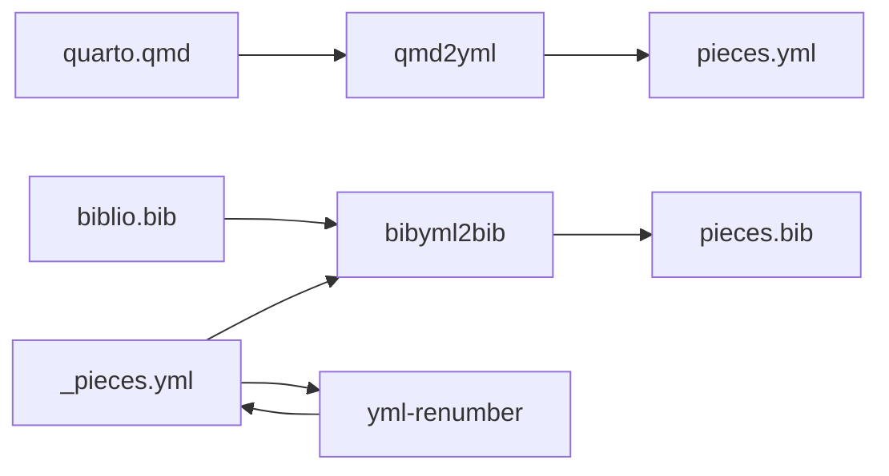

# BibTeX and bibliography tools

The `bib` group contains utilities for converting and formatting BibTeX,
JSON, Markdown, CSV, and YAML data. Use `linto help bib` to see its current
commands and pick one, or run each command with `--help`:

```sh
linto bib bib2json --help
linto bib json2bib --help
linto bib bib-order-props --help
linto bib bib2dirbibs --help
linto bib bib2awk --help
linto bib csv2qmd --help
linto bib md2json --help
linto bib qmd2yml --help
linto bib bibyml2bib --help
```

Many tools expect to run from the project directory containing the relevant
`.bib`, `.qmd`, JSON, Markdown, or YAML files. Back up important bibliography
data before using tools that modify it.

The tools share one convention:

- the main input is the first positional argument; when it is omitted or `-`,
  it is read from standard input;
- `-o`/`--output FILE` chooses the output (a directory for tools that write
  several files); the default is standard output, or `./bib` for the splitters;
- `-i` replaces the input file and `-i.bak` also keeps the original as
  `FILE.bak`; they cannot be combined with `-o` or with standard input;
- diagnostics and summaries go to standard error, so the output stays clean.

| Command | Purpose | Writes in place? |
| --- | --- | --- |
| `bib2json` | Inject BibTeX entries into a JSON file | `-o`, `-i`, `-i.bak` |
| `json2` | List the top-level properties of a JSON file | `-o` |
| `json2bib` | Rebuild BibTeX from the `bibtex` field of a JSON file | `-o`, `-i`, `-i.bak` |
| `bib-order-props` | Sort the fields of every BibTeX entry | `-o`, `-i`, `-i.bak` |
| `bib2dirbibs` | Split a BibTeX file into one file per entry | `-o DIR` (default `./bib`) |
| `bib2awk` | Extract BibTeX fields as CSV, `sed` commands, or JSON files | `-o` (`bibs`: directory, default `./bib`) |
| `csv2qmd` | Turn semicolon-separated bibliography data into a Markdown annex | `-o` |
| `md2json` | Convert Markdown files to JSON | `-o` / `--outdir` |
| `pdf2json` | Convert PDF files to JSON (text and metadata) | creates `KEY.json` |
| `pdf2md` | Convert PDF files to Markdown with a YAML frontmatter | creates `KEY.md` |
| `qmd2yml` | Number the citation keys used in a Quarto file | `-o` |
| `bibyml2bib` | Build a numbered BibTeX file from a YAML mapping | `-o` |
| `bib2db` | Compare a BibTeX file with the SQLite `pieces` table | `--apply`, or `--apply -o NEW.db` |
| `db2bib`, `db2json` | Export the SQLite `pieces` table | `-o` |
| `json2db` | Build the SQLite `pieces` table from JSON | `-o` (required) |
| `lift` | Lift `bibtex` and `frontmatter` fields to the entry level | `-o`, `-i`, `-i.bak` |
| `yml-renumber` | Renumber a YAML mapping by line number | `-o`, `-i`, `-i.bak` |

## Sort BibTeX fields

`linto bib bib-order-props [FILE.bib]` sorts the properties of every entry
alphabetically and prints the result. Use `-o FILE` to write it elsewhere, `-i`
to replace the file, or `-i.bak` to keep a copy. Put preferred fields first with
`--order`; it may be repeated, and commas separate fields. Unlisted fields follow
alphabetically:

```sh
linto bib bib-order-props -i --order author,title,year references.bib
```

Only entries with one single-line property per line are supported. The command
fails without touching the input on multiline values, comments or directives
inside an entry, duplicate fields, or unbalanced delimiters.

## Keep BibTeX and JSON in step

`linto bib bib2json [-o OUTPUT.json | -i[.bak]] [FILE.bib] [EXISTING.json]`
injects each BibTeX entry into the `bibtex` field of the matching key in the
JSON file, and creates a key (with `bibtex` and `frontmatter`) for every entry
the JSON lacks. Every record starts with a `"key"` property repeating its own
name (for example `"a": {"key": "a", ...}`), including records that were already
in the JSON.

- the BibTeX file is the first positional argument (standard input when omitted
  or `-`);
- `EXISTING.json`, the optional second argument, is the JSON to complete.
  Without it, the command starts from an empty object, so every entry is
  created;
- `-o`/`--output OUTPUT.json` is where the result goes. Without it (or with
  `-o -`), the JSON goes to standard output and the list of created keys to
  standard error, so the output stays valid JSON;
- `-i` (or `-i.bak`, which keeps `EXISTING.json.bak`) replaces `EXISTING.json`.
  It requires that argument and cannot be combined with `-o`.

```sh
linto bib bib2json refs.bib > refs.json                 # new JSON from scratch
linto bib bib2json refs.bib refs.json                   # merged result on stdout
linto bib bib2json -o merged.json refs.bib refs.json    # merged result in a file
linto bib bib2json -i.bak refs.bib refs.json            # update refs.json in place
```

`linto bib json2bib [INPUT.json]` does the reverse: it rebuilds a BibTeX file
from the `bibtex` fields, on standard output by default, in `-o FILE`, or in
place with `-i`.

`linto bib json2 [-s] [-o FILE] [FILE.json]` lists the top-level properties of a JSON
file (the record keys), one per line in file order, or sorted with `-s`. It
reads standard input when no file is given.

## Split and extract

`linto bib bib2dirbibs [-o DIR] [FILE.bib]` writes one `DIR/KEY.bib` file per
entry (`DIR` defaults to `./bib`).

`linto bib bib2awk [-o OUTPUT] [-t THEME] [-f FORMAT] [FILE.bib]` extracts fields with
GNU awk (`gawk` is required). `FORMAT` selects the handler:

- `csv` (default): semicolon-separated CSV on standard output;
- `sed`: shell commands that replace `howpublished` with `publisher`;
- `bibs`: one JSON file per entry; `-o` then names the directory (default `./bib`).

`-t THEME` keeps only entries whose keywords match the comma-separated theme.
The legacy numbers `1`, `2`, and `3` are still accepted for `-f`.

`linto bib csv2qmd [-o FILE] [-f FORMAT] [FILE.csv]` converts the semicolon-separated
output into a Markdown annex. `FORMAT` is the layout `1`, `2`, or `3`
(default `1`). The first CSV record must be the header the AWK script expects.

## Convert PDF files to JSON

`linto bib pdf2json FILE.pdf...` writes one `KEY.json` per PDF in the current
directory, where `KEY` is the file name without `.pdf`:

```json
{
  "key": "my article",
  "frontmatter": { "title": "...", "author": "...", "date": "...", "pages": 12 },
  "text": "The text of the PDF..."
}
```

`text` comes from `pdftotext`; add `--layout` to keep the page layout. With
`--engine pdf2txt` it comes from `pdf2txt` (pdfminer.six) instead, which is also
used automatically when `pdftotext` is not installed (`--layout` then has no
effect). The default is `--engine auto`.
`frontmatter` gathers every piece of metadata available: the standard fields
from `pdfinfo` (title, author, subject, keywords, creator, producer, `date` and
`modified` as ISO dates, page count and size, PDF version, and so on), any
non-standard entry of the PDF's Info dictionary (such as a place) when `qpdf` is
installed, and the fields of the document's XMP metadata. If XMP gives a
different value for a field already present, it is kept as `xmp_FIELD`.

### Fields found in the text

When the metadata lacks them, `title`, `author`, `date`, `organization`, `url`
and `note` are looked for in the first page of the document and added to the
frontmatter (at the top, in that order). The fields found this way are listed in
`guessed`, since they are heuristics:

- `title`: the largest text at the top of the first page (a metadata title such
  as `Microsoft Word - report.docx` is treated as missing and kept as
  `title_metadata`);
- `author`: a line such as `Par ...`, `By ...` or `Authors: ...`, otherwise a
  line of personal names just after the title (a junk author such as `admin` is
  kept as `author_metadata`);
- `date`: a date in the first lines, in ISO form (`2026-03-12`, `2026-03` or
  `2026`), preferring one announced by `Date :`, `Paris, le`, `Published`…;
  French and English months and `dd/mm/yyyy` are understood;
- `organization`: a header or footer line naming an université, ministère,
  association, Inc., GmbH…;
- `url`: the first web address of the first page;
- `note`: a `Note :` or `Remarque :` line, or a status such as `Brouillon`,
  `Draft` or `Version 2`.

Metadata always wins, with one exception: a PDF's own date is when the file was
made, not when the document was written, so a date found in the text replaces
it and the PDF's date moves to `created`. Metadata stored under another name
(`company`, `publisher`, `comments`, `source`…) fills `organization`, `note` and
`url` directly. Use `--no-guess` to turn the search off.

Use `-d DIR` to choose the output directory, or `-o FILE` (`-o -` for standard
output) when converting a single PDF. A file that cannot be converted is
reported and the others still are. `pdfinfo` (poppler) is required for the
metadata, and one of `pdftotext` or `pdf2txt` for the text.

`linto bib pdf2md FILE.pdf...` does the same but writes `KEY.md`: a YAML
frontmatter at the top (`key`, then the same metadata as `frontmatter` above),
followed by the text as Markdown. It takes the same `-d`, `-o`, `--engine` and
`--layout` options.

```markdown
---
key: my article
title: My article
author: Ada
pages: 12
---

First paragraph of the text...
```

The text is laid out in paragraphs: lines broken by the page layout are joined
(a line that stops short of the margin ends its paragraph) and bullets become
list items. Headings, hyphenation and tables are not detected, and lines that
would read as Markdown syntax (`# `, `1. `) are escaped.

## Convert Markdown to JSON

`linto bib md2json FILE.md...` converts Markdown files to JSON. Choose the
shape with `--format`: `simple` (default, the whole content as one string),
`structured` (headings, sections, tables, code), `flat` (a list of paragraphs),
or `metadata` (everything, with statistics). Use `-o FILE` for a single input,
`--outdir DIR` for several, and `--pretty` to indent:

```sh
linto bib md2json --format structured --pretty doc.md -o doc.json
linto bib md2json --outdir json/ *.md
```

## Build BibTeX files from a YAML mapping

`linto bib bibyml2bib` selects entries from a BibTeX file using a YAML
mapping of citation keys to numbers. Pass the BibTeX file first and the YAML
file second. Use `-` as the BibTeX file to read it from standard input:

```sh
linto bib bibyml2bib biblio.bib biblio.yml > numbered.bib
```

The YAML should contain only string keys and numeric values, for example:

```yaml
"ref-one": 1
"ref-two": 2
```

The output goes to standard output; use `-o FILE` to write a file. Entries are written in YAML
order with their `number` field set to the mapped value. Missing keys are
reported and skipped. Calling `linto bib bibyml2bib` with no arguments
retains the legacy batch mode for `_pieces-*.yml` files and `fr.bib`.

## Build a numbered references YAML from citations

`linto bib qmd2yml [-o FILE] [FILE.qmd]` extracts unique Pandoc-style citation keys and
writes a numbered YAML mapping. Use `-y`/`--yml` to extend an existing mapping:

```sh
linto bib qmd2yml --yml references.yml report.qmd
```

The existing YAML is emitted first with empty lines removed. Keys already
present in it are skipped; new keys are appended in citation order, numbered
from one greater than the last mapping value. Use `--order-by key` to sort the
new keys, or `--format csv` (one key per line) when you do not need to extend a
YAML file. With no `--yml` input, `--start NUMBER` sets the first YAML number.

## Renumber a YAML mapping

`linto bib yml-renumber [-o OUTPUT.yml | -i[.bak]] [INPUT.yml]` rewrites every
`"key": number` line so that the number is the line's position in the file. The
result goes to standard output by default, to `-o FILE`, or back into the input
with `-i`.

## Workflows











