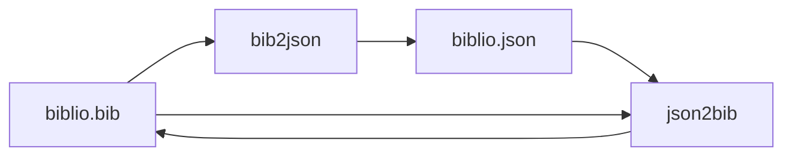
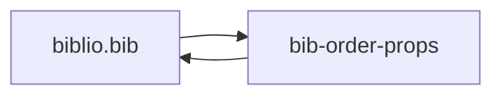
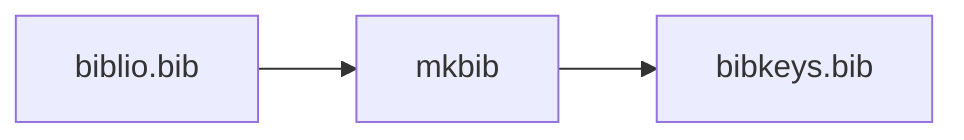
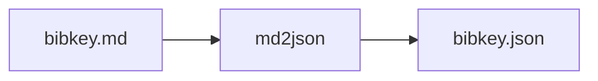
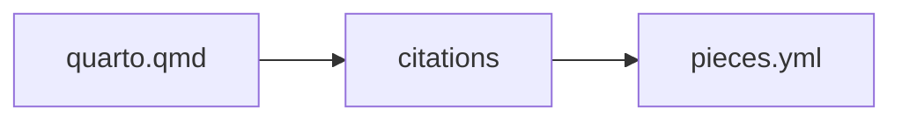

# BibTeX and bibliography tools

The `biblio` group contains utilities for converting and formatting BibTeX,
JSON, Markdown, and YAML data. Use `linto help biblio` to see its current
commands. Typical tasks include:

```sh
linto biblio bib2json --help
linto biblio json2bib --help
linto biblio bib-order-props --help
linto biblio build-bib --help
linto biblio csv2qmd --help
linto biblio md2json --help
linto biblio mkbib --help
linto biblio qmd2yml --help
linto biblio renumberyml --help
```

Many tools expect to run from the project directory containing the relevant
`.bib`, `.qmd`, JSON, Markdown, or YAML files. Check each command's `--help` for
its exact arguments and whether it writes files in place. Back up important
bibliography data before using tools that modify it.











