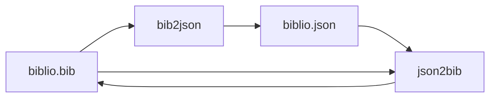
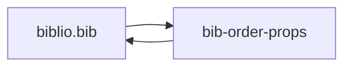
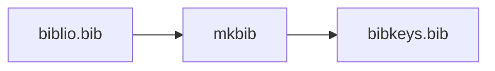
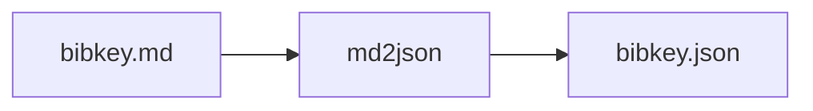
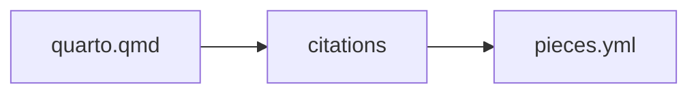

# BibTeX and bibliography tools

The `bibtex` group contains utilities for converting and formatting BibTeX,
JSON, Markdown, and YAML data. See the live list with `linto help bibtex`.

Examples:

```sh
linto bibtex bib2json --help
linto bibtex json2bib --help
linto bibtex build-bib --help
linto bibtex bib-order-props --help
linto bibtex mkbib --help
linto bibtex renumberyml --help
linto bibtex md2json --help
```

Many bibliography scripts expect to be run from the project directory containing
the relevant `.bib`, `.qmd`, or YAML files. Check each command's `--help` for
its exact arguments and whether it writes files in place. Back up important
bibliography data before using tools that modify it.github











