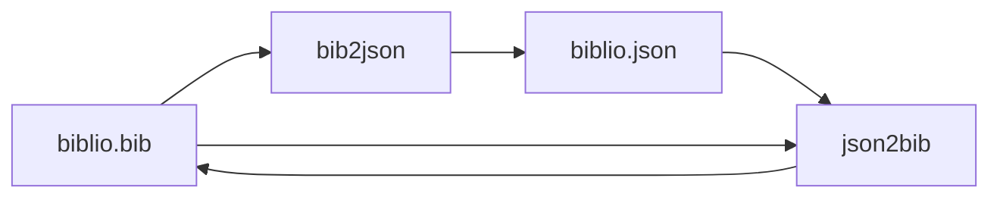
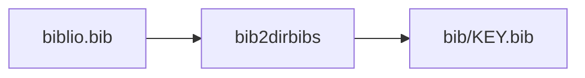
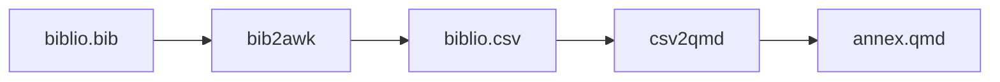
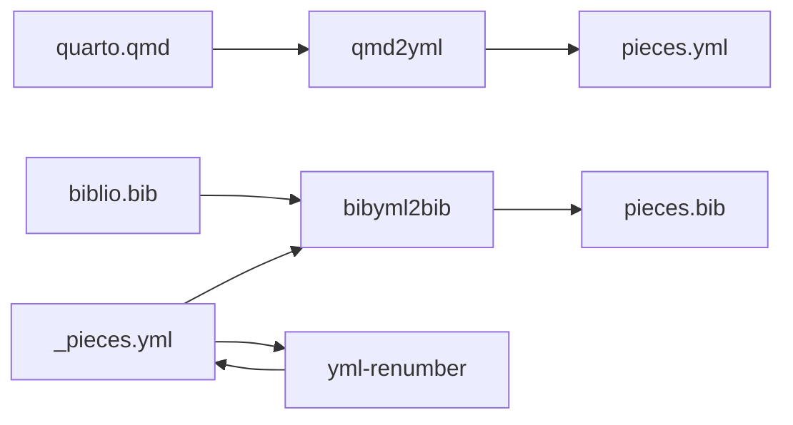

# BibTeX and bibliography tools

The `biblio` group contains utilities for converting and formatting BibTeX,
JSON, Markdown, CSV, and YAML data. Use `linto help biblio` to see its current
commands and pick one, or run each command with `--help`:

```sh
linto biblio bib2json --help
linto biblio json2bib --help
linto biblio bib-order-props --help
linto biblio bib2dirbibs --help
linto biblio bib2awk --help
linto biblio csv2qmd --help
linto biblio md2json --help
linto biblio qmd2yml --help
linto biblio bibyml2bib --help
```

`yml-renumber` has no `--help`; see [Renumber a YAML mapping](#renumber-a-yaml-mapping).

Many tools expect to run from the project directory containing the relevant
`.bib`, `.qmd`, JSON, Markdown, or YAML files. Back up important bibliography
data before using tools that modify it. The tools that can replace their input
take `-i` (replace the input file) or `-i.bak` (replace it and keep the
original as `FILE.bak`); without it, the result goes to standard output or a
new file and the input is left unchanged.

| Command | Purpose | Writes in place? |
| --- | --- | --- |
| `bib2json` | Inject BibTeX entries into a JSON file | `-i`, `-i.bak` |
| `json2` | List the top-level properties of a JSON file | no |
| `json2bib` | Rebuild BibTeX from the `bibtex` field of a JSON file | `-i`, `-i.bak` |
| `bib-order-props` | Sort the fields of every BibTeX entry | `-i`, `-i.bak` |
| `bib2dirbibs` | Split a BibTeX file into one file per entry in `./bib/` | creates files |
| `bib2awk` | Extract BibTeX fields as CSV, `sed` commands, or JSON files | `bibs` handler writes `./bib/` |
| `csv2qmd` | Turn semicolon-separated bibliography data into a Markdown annex | no |
| `md2json` | Convert Markdown files to JSON | `-o` / `--outdir` |
| `pdf2json` | Convert PDF files to JSON (text and metadata) | creates `KEY.json` |
| `qmd2yml` | Number the citation keys used in a Quarto file | no |
| `bibyml2bib` | Build a numbered BibTeX file from a YAML mapping | `-o` |
| `yml-renumber` | Renumber a YAML mapping by line number | optional output file |

## Sort BibTeX fields

`linto biblio bib-order-props FILE.bib` sorts the properties of every entry
alphabetically and prints the result. Use `-i` to replace the file, or `-i.bak`
to keep a copy. Put preferred fields first with `-o`/`--order`; it may be
repeated, and commas separate fields. Unlisted fields follow alphabetically:

```sh
linto biblio bib-order-props -i -o author,title,year references.bib
```

Only entries with one single-line property per line are supported. The command
fails without touching the input on multiline values, comments or directives
inside an entry, duplicate fields, or unbalanced delimiters.

## Keep BibTeX and JSON in step

`linto biblio bib2json [-j INPUT.json] [-o OUTPUT.json] FILE.bib` injects each
BibTeX entry into the `bibtex` field of the matching key in the JSON file, and
creates a key (with `bibtex` and `frontmatter`) for every entry the JSON lacks.
Every record starts with a `"key"` property repeating its own name (for example `"a": {"key": "a", ...}`), including records that were already in the JSON.
The BibTeX file is the only positional argument; both JSON files are options:

- `-j`/`--json INPUT.json` is the JSON to complete. Without it, the command
  starts from an empty object, so every entry is created;
- `-o`/`--output OUTPUT.json` is where the result goes. Without it (or with
  `-o -`), the JSON goes to standard output and the list of created keys to
  standard error, so the output stays valid JSON;
- `-i` (or `-i.bak`, which keeps `INPUT.json.bak`) replaces the `-j` file. It
  requires `-j` and cannot be combined with `-o`.

```sh
linto biblio bib2json refs.bib > refs.json                 # new JSON from scratch
linto biblio bib2json -j refs.json refs.bib                # merged result on stdout
linto biblio bib2json -j refs.json -o merged.json refs.bib # merged result in a file
linto biblio bib2json -i.bak -j refs.json refs.bib         # update refs.json in place
```

`linto biblio json2bib INPUT.json` does the reverse: it rebuilds a BibTeX file
from the `bibtex` fields, on standard output by default, or in place with `-i`.

`linto biblio json2 [-s] [FILE.json]` lists the top-level properties of a JSON
file (the record keys), one per line in file order, or sorted with `-s`. It
reads standard input when no file is given.

## Split and extract

`linto biblio bib2dirbibs FILE.bib` writes one `./bib/KEY.bib` file per entry.

`linto biblio bib2awk [-t THEME] [-f FORMAT] FILE.bib` extracts fields with
GNU awk (`gawk` is required). `FORMAT` selects the handler:

- `csv` (default): semicolon-separated CSV on standard output;
- `sed`: shell commands that replace `howpublished` with `publisher`;
- `bibs`: one JSON file per entry under `./bib/`.

`-t THEME` keeps only entries whose keywords match the comma-separated theme.
The legacy numbers `1`, `2`, and `3` are still accepted for `-f`.

`linto biblio csv2qmd [-f FORMAT] FILE.csv` converts the semicolon-separated
output into a Markdown annex. `FORMAT` is the layout `1`, `2`, or `3`
(default `1`). The first CSV record must be the header the AWK script expects.

## Convert PDF files to JSON

`linto biblio pdf2json FILE.pdf...` writes one `KEY.json` per PDF in the current
directory, where `KEY` is the file name without `.pdf`:

```json
{
  "key": "my article",
  "frontmatter": { "title": "...", "author": "...", "date": "...", "pages": 12 },
  "text": "The text of the PDF..."
}
```

`text` comes from `pdftotext`; add `--layout` to keep the page layout. With
`--engine pdf2txt` it comes from `pdf2txt` (pdfminer.six) instead, which is also
used automatically when `pdftotext` is not installed (`--layout` then has no
effect). The default is `--engine auto`.
`frontmatter` gathers every piece of metadata available: the standard fields
from `pdfinfo` (title, author, subject, keywords, creator, producer, `date` and
`modified` as ISO dates, page count and size, PDF version, and so on), any
non-standard entry of the PDF's Info dictionary (such as a place) when `qpdf` is
installed, and the fields of the document's XMP metadata. If XMP gives a
different value for a field already present, it is kept as `xmp_FIELD`.

Use `-d DIR` to choose the output directory, or `-o FILE` (`-o -` for standard
output) when converting a single PDF. A file that cannot be converted is
reported and the others still are. `pdfinfo` (poppler) is required for the
metadata, and one of `pdftotext` or `pdf2txt` for the text.

## Convert Markdown to JSON

`linto biblio md2json FILE.md...` converts Markdown files to JSON. Choose the
shape with `--format`: `simple` (default, the whole content as one string),
`structured` (headings, sections, tables, code), `flat` (a list of paragraphs),
or `metadata` (everything, with statistics). Use `-o FILE` for a single input,
`--outdir DIR` for several, and `--pretty` to indent:

```sh
linto biblio md2json --format structured --pretty doc.md -o doc.json
linto biblio md2json --outdir json/ *.md
```

## Build BibTeX files from a YAML mapping

`linto biblio bibyml2bib` selects entries from a BibTeX file using a YAML
mapping of citation keys to numbers. Pass the BibTeX file first and the YAML
file second:

```sh
linto biblio bibyml2bib biblio.bib biblio.yml
```

The YAML should contain only string keys and numeric values, for example:

```yaml
"ref-one": 1
"ref-two": 2
```

By default, the output is `biblio-numbered.bib`; use `-o FILE` or
`--output-file FILE` to choose another output path. Entries are written in YAML
order with their `number` field set to the mapped value. Missing keys are
reported and skipped. Calling `linto biblio bibyml2bib` with no arguments
retains the legacy batch mode for `_pieces-*.yml` files and `fr.bib`.

## Build a numbered references YAML from citations

`linto biblio qmd2yml FILE.qmd` extracts unique Pandoc-style citation keys and
writes a numbered YAML mapping. Use `-y`/`--yml` to extend an existing mapping:

```sh
linto biblio qmd2yml --yml references.yml report.qmd
```

The existing YAML is emitted first with empty lines removed. Keys already
present in it are skipped; new keys are appended in citation order, numbered
from one greater than the last mapping value. Use `--order-by key` to sort the
new keys, or `--format csv` (one key per line) when you do not need to extend a
YAML file. With no `--yml` input, `--start NUMBER` sets the first YAML number.

## Renumber a YAML mapping

`linto biblio yml-renumber INPUT.yml [OUTPUT.yml]` rewrites every
`"key": number` line so that the number is the line's position in the file. The
result goes to `OUTPUT.yml`, or to standard output when it is omitted, so the
input is never modified.

## Workflows











