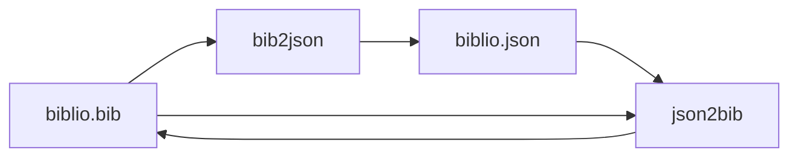
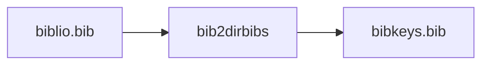
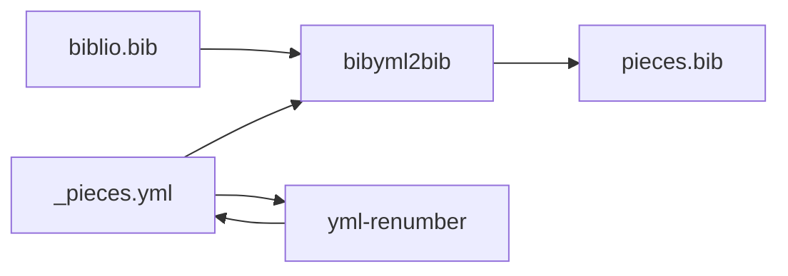
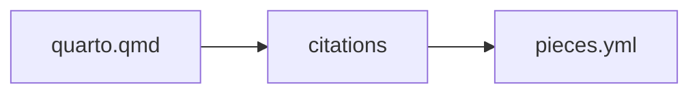

# BibTeX and bibliography tools

The `biblio` group contains utilities for converting and formatting BibTeX,
JSON, Markdown, and YAML data. Use `linto help biblio` to see its current
commands. Typical tasks include:

```sh
linto biblio bib2json --help
linto biblio json2bib --help
linto biblio bib-order-props --help
linto bibyml2bib --help
linto biblio csv2qmd --help
linto biblio md2json --help
linto bib2dirbibs --help
linto biblio qmd2yml --help
linto yml-renumber --help
```

Many tools expect to run from the project directory containing the relevant
`.bib`, `.qmd`, JSON, Markdown, or YAML files. Check each command's `--help` for
its exact arguments and whether it writes files in place. Back up important
bibliography data before using tools that modify it.

## Build BibTeX files from a YAML mapping

`linto bibyml2bib` selects entries from a BibTeX file using a YAML mapping of
citation keys to numbers. Pass the BibTeX file first and the YAML file second:

```sh
linto bibyml2bib biblio.bib biblio.yml
```

The YAML should contain only string keys and numeric values, for example:

```yaml
"ref-one": 1
"ref-two": 2
```

By default, the output is `biblio-numbered.bib`; use `-o FILE` or
`--output-file FILE` to choose another output path. Entries are written in YAML
order with their `number` field set to the mapped value. Missing keys are
reported and skipped. Calling `linto bibyml2bib` with no arguments retains the
legacy batch mode for `_pieces-*.yml` files and `fr.bib`.

## Build a numbered references YAML from citations

`linto biblio qmd2yml FILE.qmd` extracts unique Pandoc-style citation keys and
writes a numbered YAML mapping. Use `-y`/`--yml` to extend an existing mapping:

```sh
linto biblio qmd2yml --yml references.yml report.qmd
```

The existing YAML is emitted first with empty lines removed. Keys already
present in it are skipped; new keys are appended in citation order, numbered
from one greater than the last mapping value. Use `--order-by key` to sort the
new keys, or `--format csv` when you do not need to extend a YAML file. With no
`--yml` input, `--start NUMBER` sets the first YAML number.










