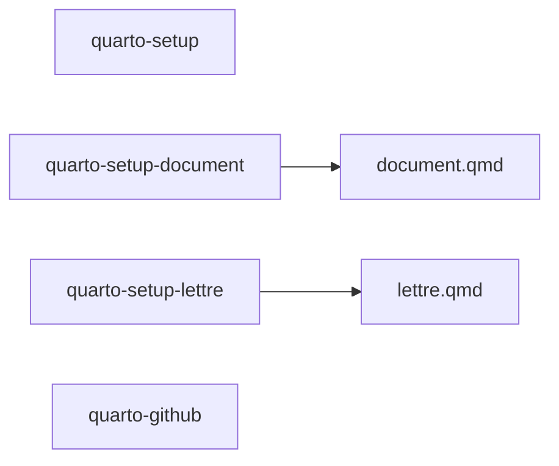
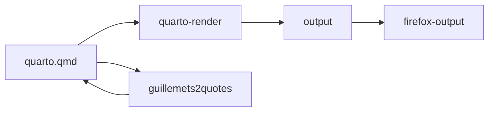

# Quarto workflow

The `quarto` group provides citation extraction, rendering helpers, output
browsing, and setup commands. Use `linto help quarto` for the current command
list. Typical invocations include:

```sh
linto quarto citations --help
linto quarto render --help
linto quarto setup --help
linto quarto setup-document --help
linto quarto setup-lettre --help
linto quarto guillemets2quotes --help
linto quarto firefox-output --help
linto quarto github --help
```

Citation extraction can produce YAML or CSV and supports ordering options; see
`linto quarto citations --help` for the supported flags. Quarto commands may
invoke the Quarto CLI and may read or write files in the current project.





